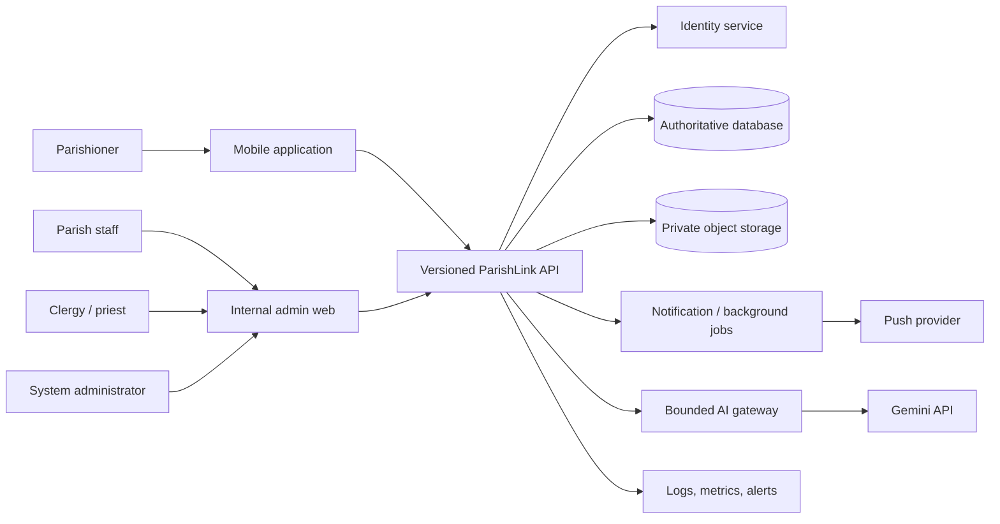

# ParishLink Architecture

## 1. Architectural goals

ParishLink uses one authoritative backend for a parishioner mobile application and an internal administrative web portal. The architecture prioritizes scheduling integrity, private-document handling, parish-scoped authorization, auditable human decisions, inclusive walk-in operations, and graceful degradation of external services.

This is a logical production architecture. The capstone paper does not prescribe a hosting vendor, identity provider, storage provider, or notification provider; those remain stakeholder decisions.

## 2. System context

Trust boundaries are at each client/API connection and at every external provider. Mobile and browser clients are untrusted presentation layers: they may hide unavailable actions for usability, but only the API authorizes and commits operations.

## 3. Client responsibilities

### Parishioner mobile application

- Authentication and account recovery UI.
- Approved parish/service discovery.
- Appointment draft, availability selection, submission, document capture/upload, and status history.
- In-app notifications and consented push registration.
- Queue ticket and live status where enabled.
- Gemini-assisted general inquiry and human handoff.
- Secure local session handling; no provider, storage, or database secret is embedded.

The mobile app does not contain internal administration, document approval, canonical eligibility decisions, or a complete sensitive record archive.

### Internal web portal

- Role- and parish-scoped operational dashboards.
- Appointment review and authorized transitions.
- Document review without public object URLs.
- Queue issuance and service controls.
- Clergy/venue availability and assignment management.
- Working-record search and controlled certificate workflow.
- Announcements, operational reports, approved evaluation reports, and audit access.
- Vicariate configuration and internal account administration for system administrators.

The portal is not a public parishioner website.

## 4. Backend modules

| Module | Responsibilities |
|---|---|
| Identity/access | Authentication integration, role mapping, parish membership, session checks, MFA policy, account disablement |
| Catalog/configuration | Parishes, service types, versioned requirements, durations, buffers, venues, office information |
| Scheduling | Availability calculation, holds if approved, overlap detection, atomic booking, reschedule/cancel policy |
| Appointments | Lifecycle, participants, review decisions, event history, optimistic concurrency |
| Documents | Upload authorization, metadata, scanning/quarantine state, reviewer workflow, private retrieval, disposal |
| Parish records | Working/index records, archive provenance, correction and approved issuance controls |
| Clergy schedules | Profiles, cross-parish assignments, venues, availability blocks, Mass/service schedules |
| Queue | Staff/mobile issuance, parish-local ordering, counter state, priority reason, estimates |
| Communications | In-app notifications, push dispatch, announcements, retry/idempotency, consent |
| Reports/evaluation | Scoped operational aggregation and validated ISO/IEC 25010 response calculation |
| AI gateway | Approved-content retrieval, prompt boundaries, redaction, rate limits, Gemini call, fallback/handoff |
| Audit/operations | Immutable security/business events, request correlation, health, metrics, alert signals |

Domain modules own business rules; client components and route handlers must not duplicate authoritative transitions or conflict logic.

## 5. Critical flows

### 5.1 Conflict-safe appointment request

1. Client requests availability for service, parish, requested window, and any selected clergy/venue.
2. API loads active service duration/buffers, approved availability, closures, active appointments, and assignments.
3. API returns candidates as informational availability, not a reservation unless an explicit expiring hold exists.
4. Client submits the chosen slot with an idempotency key.
5. In one protected commit boundary, the API revalidates permissions/input and checks buffered interval overlap for both clergy and venue.
6. If conflict-free, the API creates the appointment and event and schedules a notification. If not, no partial appointment is created and a `409` response offers refresh/alternatives.
7. Retrying the same idempotency key returns the original result rather than creating a duplicate.

Intervals use `[start, end)`. A conflict exists when `newStart < existingEnd && newEnd > existingStart`; configured buffers expand the compared window. Conflict scope is vicariate-wide for shared clergy and resources, not limited to one parish screen.

### 5.2 Private document submission

1. API verifies appointment ownership and returns a short-lived upload authorization for the exact requirement, content type, and size ceiling.
2. Client uploads directly or through the API to a private quarantine namespace.
3. Backend records metadata and checksum, validates type/size, and requests malware scanning where supported.
4. Clean files enter `submitted`; suspicious/failed files remain unavailable and produce a safe replacement message.
5. Authorized, parish-scoped personnel obtain a short-lived private view URL and decide `verified` or `needs_replacement` with an audit event.
6. Storage disposal follows the approved retention schedule. Object contents and private review notes are never sent to Gemini.

### 5.3 Reliable notifications

Business state is committed before delivery. A transactional outbox or equivalent durable event record is used so retrying push delivery cannot duplicate the appointment action. In-app notification is authoritative; push is a convenience channel and uses privacy-safe preview text.

### 5.4 Queue service

Staff can issue a ticket for a person without an account. Ordering is parish-local and policy-driven. Claim/call-next is atomic so two counters cannot serve the same ticket. Estimates are derived from recent measured throughput and labeled estimates; absence of sufficient data suppresses the estimate.

### 5.5 Gemini guidance

The API, never the mobile client, calls Gemini. The gateway uses only approved public parish/service content, a restrictive system policy, redaction, output validation, rate limits, and a deterministic fallback. It has no mutation tools and no access to private objects, sacramental record bodies, eligibility decisions, or credentials.

## 6. Data and consistency

- Authoritative timestamps are stored in UTC and displayed in `Asia/Manila` unless an export explicitly states otherwise.
- Identifiers are opaque; human references are unique but are not authorization tokens.
- Mutable resources carry a `version` or equivalent condition for optimistic concurrency.
- Appointment/document transitions and queue claims are validated server-side and written with event/audit records.
- Database indexes accelerate time-window and scope queries but do not by themselves guarantee conflict prevention; the protected recheck at commit is mandatory.
- Uploaded objects are separated from relational metadata and remain private by default.
- Cache entries may contain only data appropriate to their scope and must be invalidated on relevant changes.

See [`DATA_MODEL.md`](DATA_MODEL.md) for the conceptual schema.

## 7. Security boundaries

- Authentication proves identity; RBAC plus parish/resource scope authorizes each action.
- System administrators have broad operational access but do not automatically receive unrestricted private-document access without a defined purpose and audit trail.
- Every lookup must apply ownership or membership scope before data leaves the server.
- Input validation, output encoding, CSRF/same-origin protection, rate limits, file controls, secret management, and dependency scanning are required.
- Audit records avoid storing raw credentials, document contents, access tokens, or unnecessary personal data.

Detailed controls are in [`RBAC.md`](RBAC.md) and [`SECURITY_PRIVACY.md`](SECURITY_PRIVACY.md).

## 8. Deployment topology

Development, staging, and production are isolated environments with separate credentials, databases, object namespaces, AI/provider keys, push registrations, and observability. Production configuration is injected at deploy time. Schema changes use reviewed forward migrations and tested rollback or restore procedures. No provider is assumed until DEC-007 is approved.

## 9. Availability and degradation

| Failure | Required behavior |
|---|---|
| Gemini unavailable | Show deterministic approved guidance/handoff; other modules continue. |
| Push provider unavailable | Preserve in-app notification; retry delivery with backoff and alert on backlog. |
| Object scan unavailable | Keep new files quarantined; never auto-verify; inform user of delay. |
| Object storage unavailable | Do not lose appointment data; disable upload/view with recoverable guidance. |
| Database write uncertain | Use request/idempotency key to determine prior outcome before retrying. |
| Stale availability | Recheck at commit and return conflict without partial data. |
| Monitoring unavailable | Alert through independent channel where possible and avoid blind high-risk deployment. |

## 10. Architectural decision records to finalize

Before production, record the selected hosting/identity/push/storage/Gemini providers, regional and processor terms, database consistency strategy, file scanning service, retention/deletion implementation, backup objectives, supported device/browser matrix, and official-certificate policy. These decisions close items in [`ASSUMPTIONS_GAPS.md`](ASSUMPTIONS_GAPS.md); architecture defaults are not stakeholder approval.
