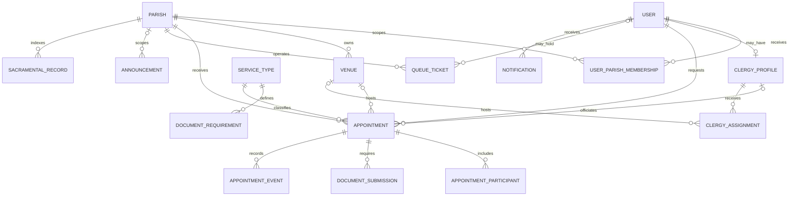

# ParishLink Data Model

## 1. Modeling principles

- One shared data model serves mobile and internal web clients.
- Every operational record is scoped to a parish or explicitly vicariate-wide.
- Human-readable references are separate from opaque primary keys.
- Status changes are controlled transitions, not free-form strings.
- Current state and append-only history are both retained for sensitive workflows.
- Prototype data and document lists are seed/demo material until authorized validation.
- Sacramental records in ParishLink are working/index copies unless verified against the official archive; the system does not replace canonical records or authority.

## 2. Core entities

| Entity | Purpose | Important relationships and constraints |
|---|---|---|
| `parishes` | Eight participating parish configurations | Unique slug; `Asia/Manila` presentation zone; active flag |
| `users` | Identity-linked account profile and primary role | Unique normalized login identifier; optional home parish; active/disabled state |
| `user_parish_memberships` | Staff/clergy scope across one or more parishes | Unique user/parish pair; permission scope validated on every request |
| `service_types` | Baptism, Wedding, Confirmation, First Communion, Funeral Mass | Unique slug; duration and buffers; additional types inactive until approved |
| `clergy_profiles` | Clergy operational profile | One profile per clergy user; home parish is not the full assignment scope |
| `venues` | Parish-owned scheduling resources | Unique parish/name; capacity optional and policy-driven |
| `availability_blocks` | Availability, closures, leave, or reserved intervals | Valid `starts_at < ends_at`; may target clergy and/or venue; creator retained |
| `document_requirements` | Versioned checklist configuration | Service and, when required, parish applicability; required flag and order |
| `appointments` | Authoritative appointment request/current state | Unique reference; parishioner, parish, service, interval; optional clergy/venue; version for concurrency |
| `appointment_participants` | People relevant to an appointment | Data minimization by service; not used as an authentication identity |
| `document_submissions` | Private object metadata and review state | One current item per appointment/requirement version; storage key is never public |
| `appointment_events` | Append-only lifecycle history | Actor, type, from/to state, reason/detail, timestamp |
| `queue_tickets` | Parish walk-in/mobile queue state | Unique parish/number scope; optional account; state and counter timestamps |
| `notifications` | In-app message and delivery metadata | Recipient, related entity, delivered/read times; no secret content |
| `announcements` | Draft/scheduled/published parish or vicariate content | Author, scope, publish/expiry times; safely rendered body |
| `sacramental_records` | Searchable working/index record | Parish, type, subject, event date, archive reference/provenance and verification |
| `clergy_assignments` | Cross-parish clergy/venue service schedule | Interval and status; conflict checked against all active assignments/appointments |
| `chatbot_messages` | Minimal, redacted AI interaction metadata | Session/category/provider request; retention and content fields subject to DEC-005 |
| `evaluation_responses` | Actual consented quality-evaluation answers | Respondent group, item code, one of eight characteristics, score 1–4, timestamp |
| `audit_logs` | Security and privileged-business audit | Actor, action, entity, parish, outcome, request ID, safe detail, timestamp |

The implementation may add supporting entities such as checklist versions, upload scan events, notification outbox/delivery attempts, refresh sessions, device registrations, idempotency keys, consent records, configuration history, or data-subject request cases. Those are implementation safeguards, not claims from the paper.

## 3. Conceptual relationships



## 4. Canonical states

### 4.1 Appointment lifecycle

Canonical stored states:

| State | Meaning | Allowed next states |
|---|---|---|
| `submitted` | Request received; no decision implied | `documents_pending`, `under_review`, `cancelled`, `rejected` |
| `documents_pending` | Required items are incomplete | `under_review`, `needs_changes`, `cancelled`, `rejected` |
| `under_review` | Authorized personnel are reviewing | `needs_changes`, `ready_to_approve`, `rejected`, `cancelled` |
| `needs_changes` | Parishioner action is required | `documents_pending`, `under_review`, `cancelled` |
| `ready_to_approve` | Configured preconditions satisfied; human decision pending | `approved`, `needs_changes`, `rejected`, `cancelled` |
| `approved` | Authorized human approval and schedule commitment | `completed`, `cancelled`, `no_show`; reschedule is an audited operation |
| `rejected` | Request declined with an authorized reason | Terminal; a new request may be created |
| `completed` | Service/appointment recorded as completed | Terminal except controlled correction |
| `cancelled` | Cancelled under policy with actor/reason | Terminal except controlled reinstatement policy |
| `no_show` | Approved appointment was not attended | Terminal except controlled correction |

Mobile labels may use friendlier wording, but clients must map to these states rather than inventing a second lifecycle. `pending_verification`, `needs_action`, or `scheduled` are presentation labels only if retained; API values remain canonical.

Every transition checks role, parish/resource scope, current version, required documents, time conflict, and policy. Rejection, override, cancellation by staff, and replacement requests require an explanatory reason.

### 4.2 Document lifecycle

| State | Meaning | Allowed next states |
|---|---|---|
| `not_submitted` | Required item has no current file | `submitted`, `not_required` |
| `submitted` | File received and safe-processing completed | `under_review`, `needs_replacement` |
| `under_review` | Authorized reviewer is examining it | `verified`, `needs_replacement` |
| `verified` | Human pre-validation complete | `needs_replacement` only through audited reopening |
| `needs_replacement` | File cannot be accepted; note required | `submitted` |
| `not_required` | Authorized applicability rule/exception | `not_submitted` through audited policy correction |

Selecting a local file is not a state transition. Malware scanning or OCR never changes a file directly to `verified`.

### 4.3 Queue lifecycle

Canonical states are `waiting`, `serving`, `served`, and `cancelled`. A brief `called` presentation event may be emitted without becoming a second authoritative state, or may be added as a canonical state only through an approved migration. A counter claim from `waiting` to `serving` is atomic. Terminal tickets cannot re-enter the active queue without an audited new ticket.

### 4.4 Record lifecycle

- `working_copy`: entered/imported into ParishLink but not yet verified against the official archive.
- `verified_against_archive`: checked by an authorized custodian with verifier and timestamp.

Neither status alone authorizes official certificate issuance; DEC-006 governs issuance.

## 5. Scheduling constraints

For active appointment and assignment statuses, compare buffered half-open intervals:

```text
newStart = requestedStart - bufferBefore
newEnd   = requestedEnd + bufferAfter
conflict = newStart < existingEnd AND newEnd > existingStart
```

A commit must reject when an overlapping row uses the same clergy member or venue, including an assignment in another parish. Availability/closure blocks are also checked. `starts_at < ends_at` is mandatory. Times are stored as UTC instants and rendered using `Asia/Manila`; date-only archival events remain explicit local dates.

Indexes on `(clergy_id, starts_at, ends_at)`, `(venue_id, starts_at, ends_at)`, and `(parish_id, status, starts_at)` support checks. Because an index is not a concurrency guarantee, the backend must protect the recheck/create sequence using the selected database's safe transaction or serialization mechanism and idempotency key.

## 6. Document and checklist versioning

Each appointment must retain the checklist version used at submission. Recommended fields are `version`, `effective_from`, `effective_to`, `approved_by`, and `approved_at` on a checklist version, with items linked to it. A later rule change must not silently mark an existing applicant incomplete. Authorized staff may migrate an appointment to a new version only with visible explanation and event history.

Object metadata includes storage key, original display filename, media type, byte size, checksum, scan state, uploaded/submitted time, reviewer, review note, and disposal time. Download/view links are short-lived and purpose-bound.

## 7. Integrity and uniqueness rules

- All foreign-key references must exist; deletions of historical entities use inactive flags or controlled anonymization, not cascading loss.
- Email/login uniqueness is normalized according to the selected identity provider.
- Appointment reference and sacramental-record reference are unique in their defined scope.
- A queue ticket number is unique within its parish/sequence period.
- A respondent can submit only according to the approved evaluation protocol; consent is recorded before an answer.
- Scores are integers 1–4 and characteristics are restricted to the eight named ISO/IEC 25010:2011 product-quality characteristics.
- Announcements and user-entered notes are stored as text and output-encoded; raw HTML is not trusted.
- Audit and event entries are append-only for normal application roles.

## 8. Data classification and minimization

| Class | Examples | Handling |
|---|---|---|
| Public | Approved parish name, office hours, public service guidance, published announcement | May be cached publicly after content approval |
| Internal | Operational configuration, non-sensitive aggregate reports, staff schedules | Authenticated internal access and parish scope |
| Confidential personal | Contact details, appointments, participants, notifications, queue identity | Encryption, least privilege, audited access, approved retention |
| Highly restricted | Uploaded civil/church documents, sacramental record details, private review notes, credentials/tokens | Private storage, purpose-limited access, short-lived retrieval, no AI payload, strong audit and disposal |

Only fields necessary for an approved service and research purpose are collected. Final lawful basis, notices, retention, data-subject processes, and controller/processor roles require the review in [`SECURITY_PRIVACY.md`](SECURITY_PRIVACY.md).

## 9. Audit minimum

Privileged mutations record actor, role, effective parish scope, action, entity type/ID, old/new state or safe summary, outcome, timestamp, request ID, and reason where required. Authentication, permission denial, private-file access, export, configuration change, record verification/correction, approval/rejection, queue priority override, and evaluation export are auditable. Raw document contents, passwords, tokens, or full sensitive form payloads are never written to audit logs.

## 10. Migration policy

Schema changes are forward, reviewed, and tested with representative non-production data. Every migration states data classification, backfill, validation query, compatibility window, and rollback/restore strategy. Destructive cleanup is deferred until backup and post-deploy verification are complete. Seed/demo data is unmistakably synthetic and is never promoted as real parish or evaluation evidence.
